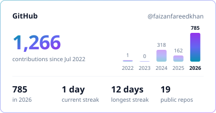
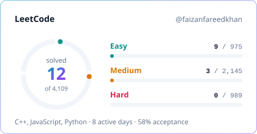
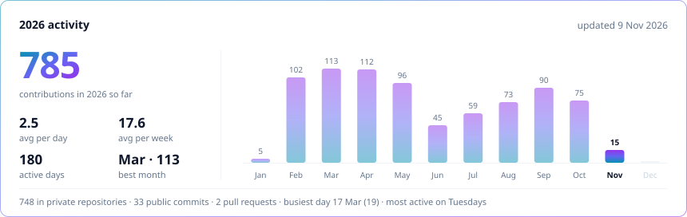

<!-- Generated by scripts/generate.mjs from templates/profile.md. Edit the template, not this file. -->
<h1 align="center">Full Stack Developer</h1>

Building web products end to end with Next.js, NestJS, Bun, Supabase and AI agents

Lahore, Pakistan · Open to new opportunities

  
  
  
  

## About me

Full Stack Developer with 3+ years of experience building production web applications with Next.js, NestJS and PostgreSQL. I work across the whole product, from database and API design to the interface people use.

- **System design:** scalable APIs, background jobs and real-time features
- **AI integration:** AI agents and LLM workflows inside real products
- **Competitive programming:** focused on algorithms and problem solving in C++ on LeetCode

## Tech stack

| Category | Technologies |
| :-- | :-- |
| **Programming Languages** |      |
| **Frontend** |             |
| **State management** |   |
| **Data fetching** |   |
| **Forms & validation** |    |
| **Backend** |          |
| **Databases** |       |
| **AI & automation** |         |
| **Integrations** |             |
| **Testing & tooling** |           |
| **DevOps & cloud** |           |

## GitHub & LeetCode

  <picture>
    <source media="(prefers-color-scheme: dark)" srcset="assets/generated/overview-dark.svg">
    
  </picture>
  <picture>
    <source media="(prefers-color-scheme: dark)" srcset="assets/generated/leetcode-dark.svg">
    
  </picture>

  <picture>
    <source media="(prefers-color-scheme: dark)" srcset="assets/generated/activity-dark.svg">
    
  </picture>

  <picture>
    <source media="(prefers-color-scheme: dark)" srcset="https://leetcard.jacoblin.cool/faizanfareedkhan?theme=dark&font=Inter&ext=heatmap&hide=ranking&animation=false">
    
  </picture>

## Recently solved on LeetCode

- [Contains Duplicate](https://leetcode.com/problems/contains-duplicate/) · C++ · 2 Nov 2026 · [solution](https://github.com/faizanfareedkhan/leet_code/tree/main/0217-contains-duplicate)
- [Subsets II](https://leetcode.com/problems/subsets-ii/) · C++ · 24 Oct 2026 · [solution](https://github.com/faizanfareedkhan/leet_code/tree/main/0090-subsets-ii)
- [Fibonacci Number](https://leetcode.com/problems/fibonacci-number/) · C++ · 20 Oct 2026 · [solution](https://github.com/faizanfareedkhan/leet_code/tree/main/0509-fibonacci-number)
- [Binary Search](https://leetcode.com/problems/binary-search/) · C++ · 20 Oct 2026 · [solution](https://github.com/faizanfareedkhan/leet_code/tree/main/0704-binary-search)
- [Subsets](https://leetcode.com/problems/subsets/) · C++ · 20 Oct 2026 · [solution](https://github.com/faizanfareedkhan/leet_code/tree/main/0078-subsets)

Stats refresh automatically every hour via GitHub Actions · updated 4 Nov 2026

