<!-- Generated by scripts/generate.mjs from templates/accent.md. Do not edit by hand. -->
> [!NOTE]
> **Style preview: Dark + accent gradient.** Other styles: [Monochrome minimal](mono.md) · [Maximal / animated](maximal.md) · [all styles](README.md)

&nbsp;
&nbsp;
&nbsp;

## About me

I build web products end to end: React and Next.js on the front, Bun, Node.js, Elysia and NestJS behind them, PostgreSQL, Supabase and Redis underneath, and AI agents wired into real workflows. Over three years of shipping products for real users. Right now I'm a full-stack engineer on [SellAnyBiz.AI](https://sellanybiz.ai).

- **Now:** shipping SellAnyBiz.AI and building 247ChatApp, a multichannel outreach inbox run by two AI agents
- **Studying:** final year at Virtual University of Pakistan, building a disease surveillance platform
- **Practising:** data structures and algorithms in C++ on LeetCode
- **Open to:** full-stack and product engineering roles

## Featured work

<table>
<tr>
<td width="50%" valign="top">

### [SellAnyBiz.AI ↗](https://sellanybiz.ai)
LIVE · FULL-STACK ENGINEER · 430+ COMMITS IN 2026

AI-powered marketplace for buying and selling private businesses: listings, NDAs, KYC, data rooms, deal checklists, a multichannel inbox and nine AI agents.

- Sole author of onboarding; main author of the chat dock, meetings, KYC pipeline, cloud imports and workspace settings
- Turned on 145 permission guards that were silently not running, with no outage
- Idempotent message sending: a retry never delivers twice

`Bun` `Next.js 16` `Elysia` `Supabase` `Redis` `BullMQ` `AI SDK`

</td>
<td width="50%" valign="top">

### 247ChatApp
PRIVATE · IN DEVELOPMENT · ENGINEERING OWNER

B2B outreach and a shared inbox for businesses that connect several WhatsApp numbers, LinkedIn accounts and email mailboxes.

- Campaign Agent prepares outreach for human approval
- Conversation Agent answers replies within each customer's rules, with human takeover
- Multiple sending accounts per business, each with its own allowance

`Next.js` `React 19` `Elysia` `Supabase` `Redis` `BullMQ` `Unipile`

</td>
</tr>
<tr>
<td width="50%" valign="top">

### SellAnyBiz Admin Portal
PRIVATE · INTERNAL TOOL

The team's operations portal: workspaces, billing and credit plans, customer bug reports, and Google rankings tracked through DataForSEO every week.

`Next.js 16` `Elysia` `Supabase` `TanStack Table` `Recharts` `Docker`

</td>
<td width="50%" valign="top">

### Disease surveillance platform
FINAL YEAR PROJECT · RESEARCH AND DESIGN

Hospitals and labs share case records; the platform forecasts malaria and typhoid trends, flags hotspots and alerts district health officers.

`Turborepo` `NestJS` `Next.js` `TypeScript` `Machine learning`

</td>
</tr>
</table>

## Tech stack

  <picture>
    <source media="(prefers-color-scheme: dark)" srcset="https://skillicons.dev/icons?i=ts,js,cpp,py,html,css,react,nextjs,vite,tailwind,materialui,redux,nodejs,bun,express,nestjs,elysia,postgres,supabase,mongodb,redis,vitest,git,docker,githubactions,vercel,cloudflare,linux&perline=14&theme=dark">
    
  </picture>

| Area | Tools |
| :-- | :-- |
| **Languages** | `TypeScript` `JavaScript` `C++` `Python` `SQL` `HTML` `CSS` |
| **Frontend** | `React` `Next.js` `Vite` `React Router` `Tailwind CSS` `shadcn/ui` `Radix UI` `MUI` `GSAP` `Framer Motion` |
| **State & forms** | `TanStack Query` `TanStack Table` `Redux Toolkit` `Zustand` `React Hook Form` `Zod` |
| **Backend** | `Node.js` `Bun` `Express` `NestJS` `Elysia` `BullMQ` `WebSockets` `JWT` `Passport` |
| **Databases** | `PostgreSQL` `Supabase` `pgvector` `MongoDB` `Mongoose` `Redis` |
| **AI & automation** | `AI agents` `Vercel AI SDK` `OpenAI API` `OpenRouter` `Ollama` `n8n` `Puppeteer` `Cheerio` |
| **Integrations** | `Stripe` `PayPal` `Google Calendar` `Google Meet` `Google Drive` `Microsoft Teams` `OneDrive` `Zoom` `Dropbox` `Unipile` `Resend` `Webhooks` |
| **Testing & tooling** | `Vitest` `Playwright` `Testing Library` `ESLint` `Prettier` `Turborepo` `Git` |
| **DevOps & cloud** | `Docker` `GitHub Actions` `Vercel` `Cloudflare` `Traefik` `Linux` |

## Stats

  <picture>
    <source media="(prefers-color-scheme: dark)" srcset="../assets/generated/overview-accent-dark.svg">
    
  </picture>
  <picture>
    <source media="(prefers-color-scheme: dark)" srcset="../assets/generated/leetcode-accent-dark.svg">
    
  </picture>

  <picture>
    <source media="(prefers-color-scheme: dark)" srcset="../assets/generated/activity-accent-dark.svg">
    
  </picture>

Generated by this repository's GitHub Action every 6 hours · includes private contributions · updated 3 Nov 2026

## Recently solved on LeetCode

- [Contains Duplicate](https://leetcode.com/problems/contains-duplicate/) · C++ · 2 Nov 2026 · [solution](https://github.com/faizanfareedkhan/leet_code/tree/main/0217-contains-duplicate)
- [Subsets II](https://leetcode.com/problems/subsets-ii/) · C++ · 24 Oct 2026 · [solution](https://github.com/faizanfareedkhan/leet_code/tree/main/0090-subsets-ii)
- [Fibonacci Number](https://leetcode.com/problems/fibonacci-number/) · C++ · 20 Oct 2026 · [solution](https://github.com/faizanfareedkhan/leet_code/tree/main/0509-fibonacci-number)
- [Binary Search](https://leetcode.com/problems/binary-search/) · C++ · 20 Oct 2026 · [solution](https://github.com/faizanfareedkhan/leet_code/tree/main/0704-binary-search)
- [Subsets](https://leetcode.com/problems/subsets/) · C++ · 20 Oct 2026 · [solution](https://github.com/faizanfareedkhan/leet_code/tree/main/0078-subsets)

## Public repositories

#### Projects

| Repository | About | Stack | Last push |
| :-- | :-- | :-- | :-- |
| [**socialMediaAutomation**](https://github.com/faizanfareedkhan/socialMediaAutomation) | Social media management for agencies: workspaces, team members, post scheduling and templates, with Google, Facebook and LinkedIn sign-in. | React · TypeScript · shadcn/ui · TanStack · Express · MongoDB | May 2025 |
| [**bot_deployment**](https://github.com/faizanfareedkhan/bot_deployment) | Puppeteer automation bot that publishes job ads in bulk across ZIP codes from an Excel sheet, with a React control panel. | Puppeteer · Express · React · Vite | Mar 2025 |
| [**fyp-2**](https://github.com/faizanfareedkhan/fyp-2) | MERN e-commerce store: catalogue, cart, orders, admin dashboard with charts, image uploads and PayPal checkout. | React · Redux Toolkit · Express · MongoDB · JWT | Jun 2025 |
| [**mern-e-commerce-project**](https://github.com/faizanfareedkhan/mern-e-commerce-project) | E-commerce storefront UI built while learning the MERN stack. | React · React Router | Jun 2024 |
| [**backend-CAC**](https://github.com/faizanfareedkhan/backend-CAC) | Two small Express.js API services. | Node.js · Express | Nov 2025 |
| [**react_portfolio**](https://github.com/faizanfareedkhan/react_portfolio) | Earlier personal portfolio site with light/dark mode and scroll animations. [Live ↗](https://faizanfareedkhan.vercel.app) | React · Tailwind CSS · DaisyUI | Dec 2024 |

#### Problem solving

| Repository | About | Stack | Last push |
| :-- | :-- | :-- | :-- |
| [**leet_code**](https://github.com/faizanfareedkhan/leet_code) | My LeetCode solutions, synced automatically from LeetCode with LeetHub. | C++ | Nov 2026 |
| [**ds_a**](https://github.com/faizanfareedkhan/ds_a) | Data structures and algorithms practice. | C++ | Aug 2026 |

<b>Learning & practice</b> · 10 repositories

| Repository | About | Stack | Last push |
| :-- | :-- | :-- | :-- |
| [**portfolio**](https://github.com/faizanfareedkhan/portfolio) | Portfolio site experiment with light/dark mode. [Live ↗](https://portfolio-yosoylilnib-gmailcoms-projects.vercel.app) | React · Tailwind CSS · DaisyUI | Apr 2025 |
| [**react**](https://github.com/faizanfareedkhan/react) | React fundamentals practice. | React | Nov 2024 |
| [**react-redux-toolkit-project**](https://github.com/faizanfareedkhan/react-redux-toolkit-project) | State management with Redux Toolkit. | React · Redux Toolkit | May 2024 |
| [**react-context-api-project-02**](https://github.com/faizanfareedkhan/react-context-api-project-02) | Context API practice, part two. | React | Jun 2024 |
| [**react-context-api-project**](https://github.com/faizanfareedkhan/react-context-api-project) | Context API practice. | React | May 2024 |
| [**react-router-dom-project**](https://github.com/faizanfareedkhan/react-router-dom-project) | Client-side routing with React Router. | React · React Router | Mar 2024 |
| [**react_int_jobs_project**](https://github.com/faizanfareedkhan/react_int_jobs_project) | Jobs listing app with a JSON Server mock API. | React · JSON Server | Apr 2024 |
| [**five-react-basic-projects**](https://github.com/faizanfareedkhan/five-react-basic-projects) | Five beginner React projects. | React | Mar 2024 |
| [**demo-demo**](https://github.com/faizanfareedkhan/demo-demo) | Git and GitHub practice. | JavaScript | Mar 2024 |
| [**localrepo**](https://github.com/faizanfareedkhan/localrepo) | My first Git repository. | HTML | Mar 2024 |

