<!-- Generated by scripts/generate.mjs from templates/maximal.md. Do not edit by hand. -->
> [!NOTE]
> **Style preview: Maximal / animated.** Other styles: [Monochrome minimal](mono.md) · [Dark + accent gradient](accent.md) · [all styles](README.md)

&nbsp;
&nbsp;
&nbsp;

## 👋 About me

- 💼 Full-stack engineer on **[SellAnyBiz.AI](https://sellanybiz.ai)**, an AI-powered marketplace for buying and selling businesses
- 🛠️ Over three years of building web products end to end, from React and Next.js to Bun, Elysia, NestJS, Postgres and Redis
- 🤖 I wire AI agents into real workflows: chat, outreach, documents and deal rooms
- 🎓 Final year at Virtual University of Pakistan, building a disease surveillance platform
- 🧠 Practising data structures and algorithms in C++ on LeetCode
- 📫 Reach me on [LinkedIn](https://www.linkedin.com/in/faizan-fareed-khan-684208243/) or at [yosoylilnib@gmail.com](mailto:yosoylilnib@gmail.com)

## 🚀 Featured work

<table>
<tr>
<td width="50%" valign="top">

### 🏢 [SellAnyBiz.AI](https://sellanybiz.ai)
`🟢 Live` `👨‍💻 430+ commits in 2026`

AI marketplace for buying and selling private businesses: listings, NDAs, KYC, data rooms, deal checklists, a multichannel inbox and **nine AI agents**.

✅ Sole author of onboarding 
✅ Chat dock, meetings, KYC pipeline, cloud imports 
✅ Turned on 145 silent permission guards, no outage 
✅ Idempotent message sending

</td>
<td width="50%" valign="top">

### 💬 247ChatApp
`🔒 Private` `🧪 In development`

B2B outreach and shared inbox across many WhatsApp numbers, LinkedIn accounts and email mailboxes.

🤖 Campaign Agent drafts outreach for approval 
🤖 Conversation Agent replies within each customer's rules 
🙋 Human takeover at any point 
⚙️ Next.js · Elysia · Supabase · BullMQ · Unipile

</td>
</tr>
<tr>
<td width="50%" valign="top">

### 🛡️ SellAnyBiz Admin Portal
`🔒 Private` `🧰 Internal tool`

Operations portal: workspaces, billing and credit plans, customer bug reports and weekly Google-ranking checks through DataForSEO.

⚙️ Next.js 16 · Elysia · Supabase · Recharts · Docker

</td>
<td width="50%" valign="top">

### 🏥 Disease surveillance platform
`🎓 Final year project` `🔬 Research`

Hospitals and labs share case records; ML forecasts malaria and typhoid trends, flags hotspots and alerts district health officers.

⚙️ Turborepo · NestJS · Next.js · TypeScript

</td>
</tr>
</table>

## 🧰 Tech stack

  <picture>
    <source media="(prefers-color-scheme: dark)" srcset="https://skillicons.dev/icons?i=ts,js,cpp,py,react,nextjs,nodejs,bun,elysia,nestjs,express,postgres,supabase,mongodb,redis,tailwind,docker,githubactions,vercel,cloudflare,git,linux&perline=11&theme=dark">
    
  </picture>

<b>Languages</b> 
      
  
<b>Frontend</b> 
         
  
<b>State & forms</b> 
     
  
<b>Backend</b> 
        
  
<b>Databases</b> 
     
  
<b>AI & automation</b> 
       
  
<b>Integrations</b> 
           
  
<b>Testing & tooling</b> 
      
  
<b>DevOps & cloud</b> 
     

## 📊 GitHub & LeetCode

  <picture>
    <source media="(prefers-color-scheme: dark)" srcset="../assets/generated/overview-accent-dark.svg">
    
  </picture>
  <picture>
    <source media="(prefers-color-scheme: dark)" srcset="../assets/generated/leetcode-accent-dark.svg">
    
  </picture>

  <picture>
    <source media="(prefers-color-scheme: dark)" srcset="../assets/generated/activity-accent-dark.svg">
    
  </picture>

  <picture>
    <source media="(prefers-color-scheme: dark)" srcset="https://leetcard.jacoblin.cool/yosoylilnib?theme=dark&font=Inter&ext=heatmap">
    
  </picture>

## 🧩 Recently solved on LeetCode

- [Contains Duplicate](https://leetcode.com/problems/contains-duplicate/) · C++ · 2 Nov 2026 · [solution](https://github.com/faizanfareedkhan/leet_code/tree/main/0217-contains-duplicate)
- [Subsets II](https://leetcode.com/problems/subsets-ii/) · C++ · 24 Oct 2026 · [solution](https://github.com/faizanfareedkhan/leet_code/tree/main/0090-subsets-ii)
- [Fibonacci Number](https://leetcode.com/problems/fibonacci-number/) · C++ · 20 Oct 2026 · [solution](https://github.com/faizanfareedkhan/leet_code/tree/main/0509-fibonacci-number)
- [Binary Search](https://leetcode.com/problems/binary-search/) · C++ · 20 Oct 2026 · [solution](https://github.com/faizanfareedkhan/leet_code/tree/main/0704-binary-search)
- [Subsets](https://leetcode.com/problems/subsets/) · C++ · 20 Oct 2026 · [solution](https://github.com/faizanfareedkhan/leet_code/tree/main/0078-subsets)

## 📂 Public repositories

#### Projects

| Repository | About | Stack | Last push |
| :-- | :-- | :-- | :-- |
| [**socialMediaAutomation**](https://github.com/faizanfareedkhan/socialMediaAutomation) | Social media management for agencies: workspaces, team members, post scheduling and templates, with Google, Facebook and LinkedIn sign-in. | React · TypeScript · shadcn/ui · TanStack · Express · MongoDB | May 2025 |
| [**bot_deployment**](https://github.com/faizanfareedkhan/bot_deployment) | Puppeteer automation bot that publishes job ads in bulk across ZIP codes from an Excel sheet, with a React control panel. | Puppeteer · Express · React · Vite | Mar 2025 |
| [**fyp-2**](https://github.com/faizanfareedkhan/fyp-2) | MERN e-commerce store: catalogue, cart, orders, admin dashboard with charts, image uploads and PayPal checkout. | React · Redux Toolkit · Express · MongoDB · JWT | Jun 2025 |
| [**mern-e-commerce-project**](https://github.com/faizanfareedkhan/mern-e-commerce-project) | E-commerce storefront UI built while learning the MERN stack. | React · React Router | Jun 2024 |
| [**backend-CAC**](https://github.com/faizanfareedkhan/backend-CAC) | Two small Express.js API services. | Node.js · Express | Nov 2025 |
| [**react_portfolio**](https://github.com/faizanfareedkhan/react_portfolio) | Earlier personal portfolio site with light/dark mode and scroll animations. [Live ↗](https://faizanfareedkhan.vercel.app) | React · Tailwind CSS · DaisyUI | Dec 2024 |

#### Problem solving

| Repository | About | Stack | Last push |
| :-- | :-- | :-- | :-- |
| [**leet_code**](https://github.com/faizanfareedkhan/leet_code) | My LeetCode solutions, synced automatically from LeetCode with LeetHub. | C++ | Nov 2026 |
| [**ds_a**](https://github.com/faizanfareedkhan/ds_a) | Data structures and algorithms practice. | C++ | Aug 2026 |

<b>Learning & practice</b> · 10 repositories

| Repository | About | Stack | Last push |
| :-- | :-- | :-- | :-- |
| [**portfolio**](https://github.com/faizanfareedkhan/portfolio) | Portfolio site experiment with light/dark mode. [Live ↗](https://portfolio-yosoylilnib-gmailcoms-projects.vercel.app) | React · Tailwind CSS · DaisyUI | Apr 2025 |
| [**react**](https://github.com/faizanfareedkhan/react) | React fundamentals practice. | React | Nov 2024 |
| [**react-redux-toolkit-project**](https://github.com/faizanfareedkhan/react-redux-toolkit-project) | State management with Redux Toolkit. | React · Redux Toolkit | May 2024 |
| [**react-context-api-project-02**](https://github.com/faizanfareedkhan/react-context-api-project-02) | Context API practice, part two. | React | Jun 2024 |
| [**react-context-api-project**](https://github.com/faizanfareedkhan/react-context-api-project) | Context API practice. | React | May 2024 |
| [**react-router-dom-project**](https://github.com/faizanfareedkhan/react-router-dom-project) | Client-side routing with React Router. | React · React Router | Mar 2024 |
| [**react_int_jobs_project**](https://github.com/faizanfareedkhan/react_int_jobs_project) | Jobs listing app with a JSON Server mock API. | React · JSON Server | Apr 2024 |
| [**five-react-basic-projects**](https://github.com/faizanfareedkhan/five-react-basic-projects) | Five beginner React projects. | React | Mar 2024 |
| [**demo-demo**](https://github.com/faizanfareedkhan/demo-demo) | Git and GitHub practice. | JavaScript | Mar 2024 |
| [**localrepo**](https://github.com/faizanfareedkhan/localrepo) | My first Git repository. | HTML | Mar 2024 |

⚡ Stats refresh automatically every 6 hours via GitHub Actions · updated 3 Nov 2026

