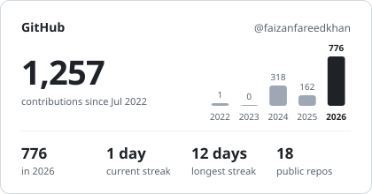
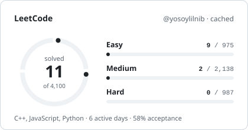
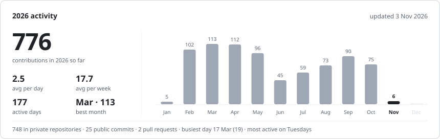

<!-- Generated by scripts/generate.mjs from templates/mono.md. Do not edit by hand. -->
> [!NOTE]
> **Style preview: Monochrome minimal.** Other styles: [Dark + accent gradient](accent.md) · [Maximal / animated](maximal.md) · [all styles](README.md)

# Faizan Fareed Khan

**Full Stack Engineer** · Lahore, Pakistan · open to new opportunities

I build web products end to end: React and Next.js on the front, Bun, Node.js, Elysia and NestJS behind them, PostgreSQL, Supabase and Redis underneath, and AI agents wired into real workflows. Over three years of shipping products for real users. Right now I'm a full-stack engineer on [SellAnyBiz.AI](https://sellanybiz.ai), an AI-powered marketplace for buying and selling businesses.

[LinkedIn](https://www.linkedin.com/in/faizan-fareed-khan-684208243/) · [Email](mailto:yosoylilnib@gmail.com) · [LeetCode](https://leetcode.com/u/yosoylilnib/)

---

### Now

- Shipping **SellAnyBiz.AI**: messaging and realtime, meetings, KYC, data-room cloud imports, workspaces and onboarding
- Building **247ChatApp**: a multichannel B2B outreach inbox run by two AI agents
- Designing my **final year project** at Virtual University: a disease surveillance and early-warning platform
- Practising data structures and algorithms in C++ on LeetCode

### Featured work

#### [SellAnyBiz.AI](https://sellanybiz.ai) &nbsp;`live`

An AI-powered marketplace for buying and selling private businesses. It carries a deal from the first listing to closing: listings, NDAs, identity checks, data rooms, deal checklists, a multichannel inbox and nine AI agents. I'm one of four core engineers, with 430+ commits in 2026.

- Sole author of onboarding; main author of the chat dock, meetings (Zoom, Google Meet, Teams), the KYC identity pipeline, data-room cloud imports and workspace settings
- Found 145 permission guards that were silently not running and turned them on without an outage
- Made message sending idempotent, so a retry can never deliver a message twice

The platform runs on 189 Postgres tables, 106 background queues and about 3,900 automated tests, with three app replicas behind Cloudflare and Traefik.

`Bun` `Next.js 16` `React 19` `Elysia` `Supabase` `pgvector` `Redis` `BullMQ` `Vercel AI SDK` `Stripe` `Docker`

#### SellAnyBiz Admin Portal &nbsp;`private`

The internal portal for the SellAnyBiz team: workspaces, billing and credit plans, customer bug reports, and Google rankings tracked through DataForSEO on a weekly schedule. A Next.js 16 and Elysia app that shares the main product's Supabase project and ships as its own Docker deployment.

`Next.js 16` `Elysia` `Supabase` `TanStack Table` `Recharts` `Redis` `Docker`

#### 247ChatApp &nbsp;`private` `in development`

B2B outreach and a shared inbox for businesses that connect several WhatsApp numbers, LinkedIn accounts and email mailboxes. A Campaign Agent prepares outreach for human approval, and a Conversation Agent answers replies within each customer's rules, with human takeover. I own the ongoing engineering work.

`Next.js` `React 19` `Elysia` `Supabase` `Redis` `BullMQ` `Unipile` `Zod` `Playwright`

#### Disease surveillance and early-warning platform &nbsp;`final year project`

My final year project at Virtual University of Pakistan. Hospitals and labs share case records; the platform forecasts malaria and typhoid trends, flags geographic hotspots and alerts district health officers. Currently in research and system design.

`Turborepo` `NestJS` `Next.js` `TypeScript` `Bun` `Machine learning`

**Also built:** resumable Puppeteer scrapers with live progress dashboards and Excel export, a load tester that finds where an API starts rate limiting, and custom Elementor/WordPress UI for clients.

### Tech stack

| Area | Tools |
| :-- | :-- |
| **Languages** |        |
| **Frontend** |           |
| **State & forms** |       |
| **Backend** |          |
| **Databases** |       |
| **AI & automation** |         |
| **Integrations** |             |
| **Testing & tooling** |        |
| **DevOps & cloud** |       |

### Stats

  <picture>
    <source media="(prefers-color-scheme: dark)" srcset="../assets/generated/overview-mono-dark.svg">
    
  </picture>
  <picture>
    <source media="(prefers-color-scheme: dark)" srcset="../assets/generated/leetcode-mono-dark.svg">
    
  </picture>

<picture>
  <source media="(prefers-color-scheme: dark)" srcset="../assets/generated/activity-mono-dark.svg">
  
</picture>

Built by this repository's GitHub Action from the GitHub and LeetCode APIs, refreshed every 6 hours. Contribution counts include private work. Last updated 3 Nov 2026.

### Recently solved on LeetCode

- [Contains Duplicate](https://leetcode.com/problems/contains-duplicate/) · C++ · 2 Nov 2026 · [solution](https://github.com/faizanfareedkhan/leet_code/tree/main/0217-contains-duplicate)
- [Subsets II](https://leetcode.com/problems/subsets-ii/) · C++ · 24 Oct 2026 · [solution](https://github.com/faizanfareedkhan/leet_code/tree/main/0090-subsets-ii)
- [Fibonacci Number](https://leetcode.com/problems/fibonacci-number/) · C++ · 20 Oct 2026 · [solution](https://github.com/faizanfareedkhan/leet_code/tree/main/0509-fibonacci-number)
- [Binary Search](https://leetcode.com/problems/binary-search/) · C++ · 20 Oct 2026 · [solution](https://github.com/faizanfareedkhan/leet_code/tree/main/0704-binary-search)
- [Subsets](https://leetcode.com/problems/subsets/) · C++ · 20 Oct 2026 · [solution](https://github.com/faizanfareedkhan/leet_code/tree/main/0078-subsets)

### Public repositories

#### Projects

| Repository | About | Stack | Last push |
| :-- | :-- | :-- | :-- |
| [**socialMediaAutomation**](https://github.com/faizanfareedkhan/socialMediaAutomation) | Social media management for agencies: workspaces, team members, post scheduling and templates, with Google, Facebook and LinkedIn sign-in. | React · TypeScript · shadcn/ui · TanStack · Express · MongoDB | May 2025 |
| [**bot_deployment**](https://github.com/faizanfareedkhan/bot_deployment) | Puppeteer automation bot that publishes job ads in bulk across ZIP codes from an Excel sheet, with a React control panel. | Puppeteer · Express · React · Vite | Mar 2025 |
| [**fyp-2**](https://github.com/faizanfareedkhan/fyp-2) | MERN e-commerce store: catalogue, cart, orders, admin dashboard with charts, image uploads and PayPal checkout. | React · Redux Toolkit · Express · MongoDB · JWT | Jun 2025 |
| [**mern-e-commerce-project**](https://github.com/faizanfareedkhan/mern-e-commerce-project) | E-commerce storefront UI built while learning the MERN stack. | React · React Router | Jun 2024 |
| [**backend-CAC**](https://github.com/faizanfareedkhan/backend-CAC) | Two small Express.js API services. | Node.js · Express | Nov 2025 |
| [**react_portfolio**](https://github.com/faizanfareedkhan/react_portfolio) | Earlier personal portfolio site with light/dark mode and scroll animations. [Live ↗](https://faizanfareedkhan.vercel.app) | React · Tailwind CSS · DaisyUI | Dec 2024 |

#### Problem solving

| Repository | About | Stack | Last push |
| :-- | :-- | :-- | :-- |
| [**leet_code**](https://github.com/faizanfareedkhan/leet_code) | My LeetCode solutions, synced automatically from LeetCode with LeetHub. | C++ | Nov 2026 |
| [**ds_a**](https://github.com/faizanfareedkhan/ds_a) | Data structures and algorithms practice. | C++ | Aug 2026 |

<b>Learning & practice</b> · 10 repositories

| Repository | About | Stack | Last push |
| :-- | :-- | :-- | :-- |
| [**portfolio**](https://github.com/faizanfareedkhan/portfolio) | Portfolio site experiment with light/dark mode. [Live ↗](https://portfolio-yosoylilnib-gmailcoms-projects.vercel.app) | React · Tailwind CSS · DaisyUI | Apr 2025 |
| [**react**](https://github.com/faizanfareedkhan/react) | React fundamentals practice. | React | Nov 2024 |
| [**react-redux-toolkit-project**](https://github.com/faizanfareedkhan/react-redux-toolkit-project) | State management with Redux Toolkit. | React · Redux Toolkit | May 2024 |
| [**react-context-api-project-02**](https://github.com/faizanfareedkhan/react-context-api-project-02) | Context API practice, part two. | React | Jun 2024 |
| [**react-context-api-project**](https://github.com/faizanfareedkhan/react-context-api-project) | Context API practice. | React | May 2024 |
| [**react-router-dom-project**](https://github.com/faizanfareedkhan/react-router-dom-project) | Client-side routing with React Router. | React · React Router | Mar 2024 |
| [**react_int_jobs_project**](https://github.com/faizanfareedkhan/react_int_jobs_project) | Jobs listing app with a JSON Server mock API. | React · JSON Server | Apr 2024 |
| [**five-react-basic-projects**](https://github.com/faizanfareedkhan/five-react-basic-projects) | Five beginner React projects. | React | Mar 2024 |
| [**demo-demo**](https://github.com/faizanfareedkhan/demo-demo) | Git and GitHub practice. | JavaScript | Mar 2024 |
| [**localrepo**](https://github.com/faizanfareedkhan/localrepo) | My first Git repository. | HTML | Mar 2024 |

